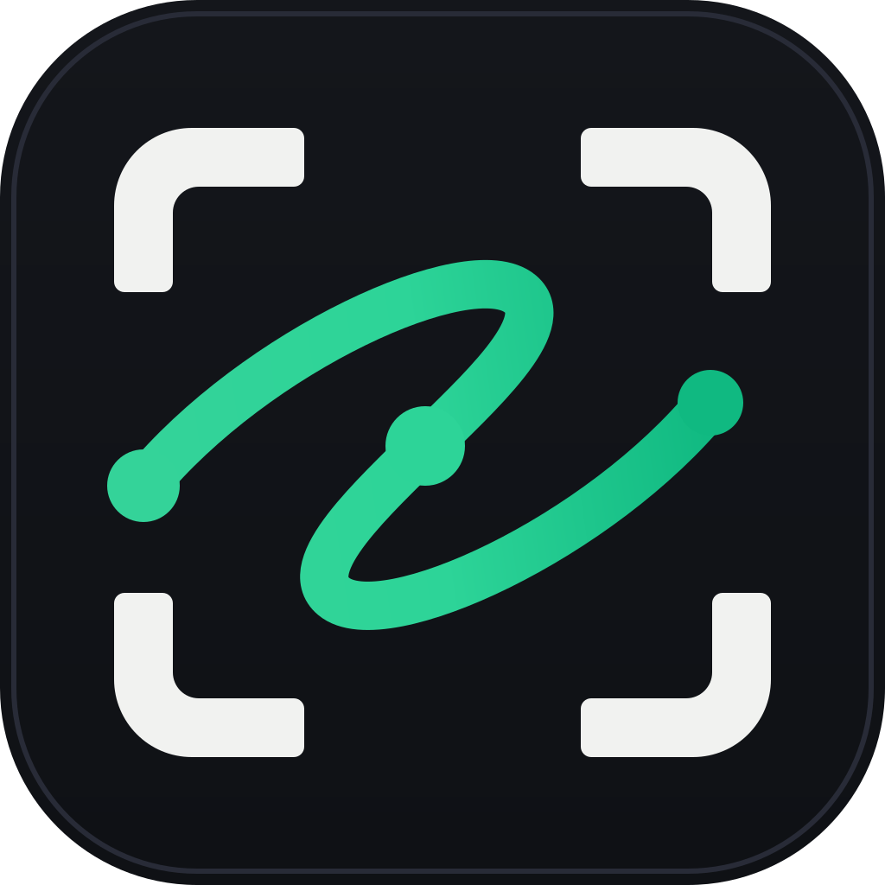
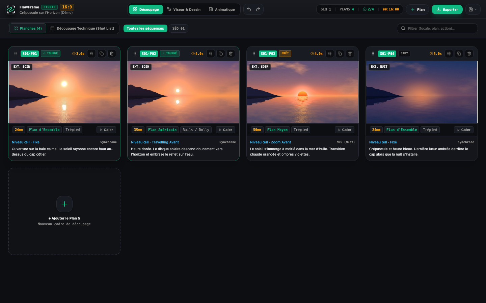
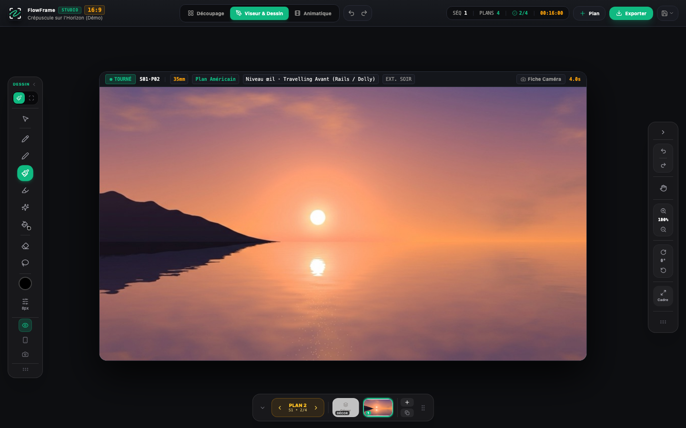
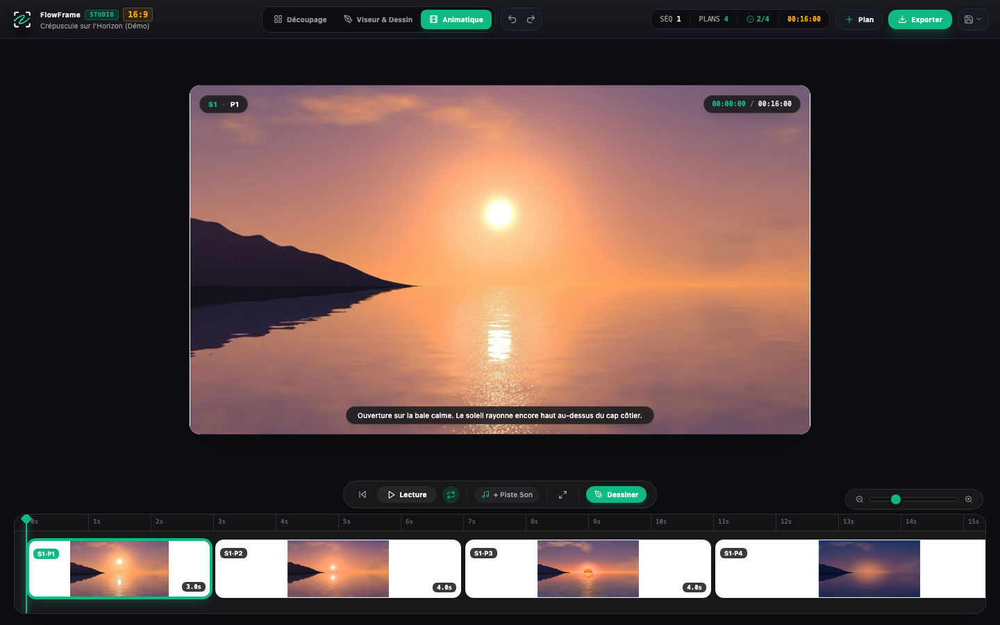

<div align="center">
  
  <h1>Flow Frame Studio</h1>
  <p><strong>Studio de Storyboard, Découpage Technique &amp; Animatique pour Mac &amp; Tablette Android</strong></p>

  <p>
    
    
    
    
  </p>
</div>

---

**Flow Frame Studio** est un studio de pré-production audiovisuelle conçu pour les réalisateurs, chefs opérateurs, étudiants en cinéma et petites équipes de tournage. Il réunit sur une interface sombre tactile et desktop le **découpage technique**, le **dessin multi-poses avec calque décor**, et le **montage animatique avec piste sonore et export montage XML**.

---

## Aperçu du Studio

### 1. Galerie des Plans & Découpage Technique
Organisez vos séquences par glisser-déposer tactile, suivez l'avancement plateau (`STBY`, `PRÊT`, `TOURNÉ`), et configurez en un tap la focale (`18mm` → `135mm`), la valeur de plan, l'axe caméra et le support.



### 2. Atelier de Dessin Tactile & Calque Décor
Panneaux modulaires interchangeables par glisser-déposer (Gauche / Droite / Bas), séparation **Dessin** vs **Cadre & Flèches vectorielles**, seau de peinture anti-fuites, outil Lasso avec transformation, mode **Stylet seul Android** (rejet de paume), plein écran immersif et gestes tactiles (**tap 2 doigts = Annuler**, **tap 3 doigts = Rétablir**).



### 3. Studio Animatique & Timeline Audio
Prévisualisez votre rythme en temps réel, ajustez la durée plan par plan, importez une piste audio (`MP3`/`WAV`) et exportez un **Dépouillement PDF**, une **vidéo animatique**, ou un **Pack Montage XML (`.zip`)** compatible avec vos logiciels de montage.



---

## Projet Démo Inclus

Un storyboard de démonstration en **4 plans 16:9** intitulé **« Crépuscule sur l'Horizon (Démo) »** est inclus directement dans l'application (bouton **Projet Démo (4 plans)** sur l'écran d'accueil) ainsi qu'en fichier autonome :

- [`demo/crepuscule-horizon-demo.json`](demo/crepuscule-horizon-demo.json)

---

## Fonctionnalités Clés

- **Découpage & Shot List 1-Tap** : Vue planches 16:9 / 2.39:1 / 4:3 / 9:16 et vue tableau technique complète avec télémétrie en direct (`SÉQ`, `PLANS`, `TOURNÉS`, Timecode).
- **Calque Décor partagé + Poses multiples** : Dessinez un décor unique réutilisé automatiquement sur toutes les poses `1, 2, 3...` d'un même plan, avec pelure d'oignon (*Onion Skin*).
- **Outils de Dessin & Mise en Scène** : Crayon, pinceau, marqueur, seau de peinture intelligent, lasso avec rotation/symétrie/duplication, aperçu 1:1 de la taille du trait au centre de la toile, flèches caméra et cadres de zoom vectoriels éditables.
- **Ergonomie Tablette Android** : Mode Stylet (rejet de paume), affichage plein écran immersif sans barre système, gestes 2 doigts (*Annuler*) / 3 doigts (*Rétablir*), pinch/rotation à 2 doigts.
- **Exports Production** :
  - **PDF Feuille de Tournage** (avec focales, supports, angles et notes lumière)
  - **Vidéo Animatique & Audio MP3**
  - **Pack Montage XML (`.zip`)** avec séquences XML/FCPXML et rendus PNG individuels
  - **Sauvegarde Projet (`.json`)** portable entre Mac et Tablette Android

---

## Téléchargement & Installation (`v1.0.1`)

Rendez-vous sur la page **[Releases v1.0.1](../../releases/tag/v1.0.1)** :

### macOS (`FlowFrameStudio-v1.0.1-macOS.dmg`)
1. Ouvrez `FlowFrameStudio-v1.0.1-macOS.dmg` et glissez **Flow Frame Studio.app** dans `/Applications`.
2. **Premier lancement (sécurité macOS / Gatekeeper)** : L'application étant open-source et gratuite (sans abonnement payant Apple Developer), macOS peut bloquer sa première ouverture. Pour l'autoriser en 2 secondes :
   - Essayez d'ouvrir l'application une première fois, puis allez dans **Réglages Système › Confidentialité et sécurité**, descendez tout en bas et cliquez sur **« Ouvrir quand même »**.
   - *(En cas de blocage persistant sur macOS Sequoia+, vous pouvez aussi lancer dans le Terminal : `xattr -cr "/Applications/Flow Frame Studio.app"`).*

### Android Tablette (`FlowFrameStudio-v1.0.1-android.apk`)
1. Téléchargez **`FlowFrameStudio-v1.0.1-android.apk`** sur votre tablette Android et lancez l'installation (APK ARM64 aligné et signé).
2. **Mises à jour automatiques GitHub** : l'application vérifie automatiquement les nouvelles releases via **Menu Projet → Mises à jour GitHub** sur `Ward-Milan/flow-frame` *(note : les mises à jour automatiques via l'API publique GitHub s'activeront automatiquement dès que ce dépôt passera de Privé à Public)*.

---

## Développement & Compilation

```bash
# Installer les dépendances
npm install

# Lancer le serveur web de développement
npm run dev

# Compiler le bundle macOS (.app + .dmg)
npm run tauri:build

# Compiler l'APK Android (ARM64)
npm run tauri:android:build
```
